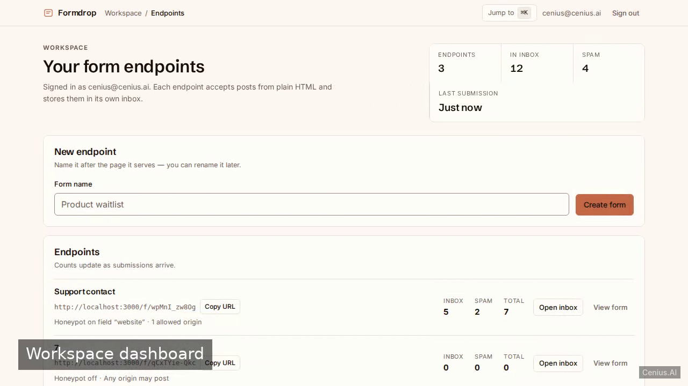
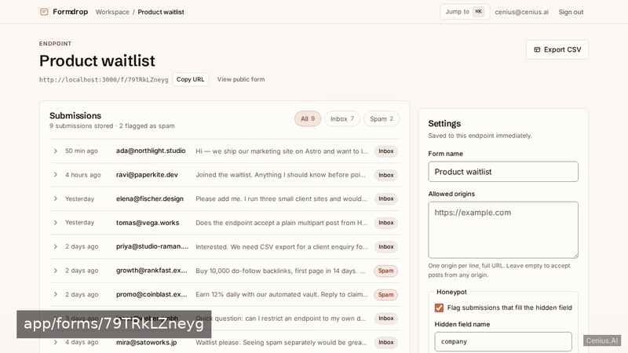
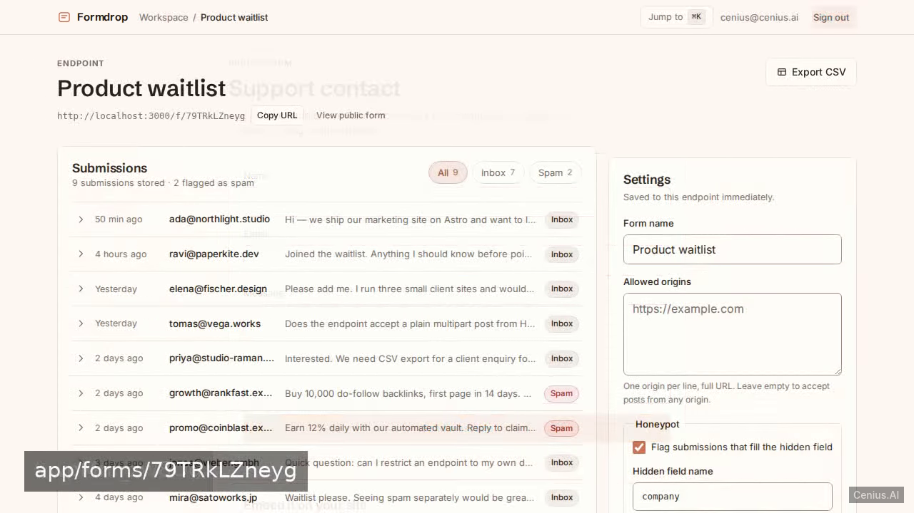
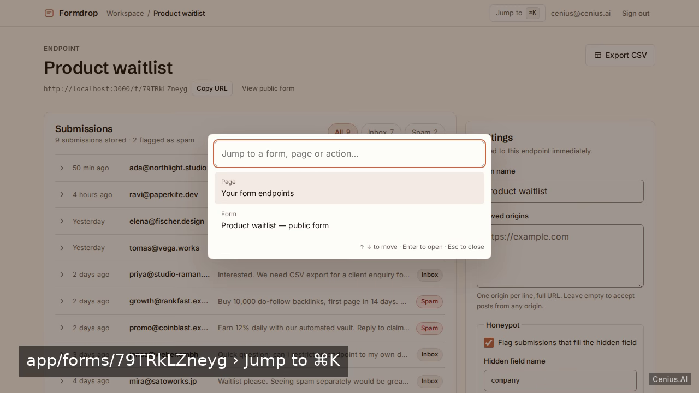

# Formdrop Form Backend Inbox — Node.js monitoring dashboard reference implementation

A Node.js monitoring dashboard, open-source and ready to self-host: that's **Formdrop Form Backend Inbox**. Formdrop is a self-hostable Formspree-style form backend for static sites: users sign in with a seeded demo account, create and manage form endpoints, and receive HTML form posts into a per-form inbox with spam flags,…. Formdrop Form Backend Inbox ships complete — source, design assets, seed data — under the Apache-2.0 license; no cloud account needed. [Remix Formdrop Form Backend Inbox on cenius.ai](https://cenius.ai/marketplace/p/formdrop-form-backend-inbox?ref=gh&utm_campaign=formdrop-form-backend-inbox-nodejs) for a custom build.


[](LICENSE)  [](https://cenius.ai)

[](https://cenius.ai/marketplace/p/formdrop-form-backend-inbox?ref=gh&utm_campaign=formdrop-form-backend-inbox-nodejs)

> **▶ [Open & edit in cenius.ai](https://cenius.ai/marketplace/p/formdrop-form-backend-inbox?ref=gh&utm_campaign=formdrop-form-backend-inbox-nodejs)** — one click to an editable workspace: describe changes in plain English, get an instant preview, one-click deploy and host. Modifications made on the platform come with full rebrand & relicense rights.

_Local clone? See [Quick start](#quick-start) below. cenius.ai is the zero-setup path._

## Demo





▶ **[See it in action](https://cenius.ai/marketplace/p/formdrop-form-backend-inbox?ref=gh&utm_campaign=formdrop-form-backend-inbox-nodejs)** — full demo on the project page · [MP4](.github/media/demo.mp4)

## Screenshots

  

## Features

- Email/password auth with seeded demo login
- Form management CRUD
- HTML form intake endpoint
- Submission inbox and spam flag
- Allowed-origin and honeypot settings
- CSV export
- Seeded demo workspace

## Architecture

A self-contained Node.js project (38 files): top-level directories include `data/`, `static/`, `tests/`. Kick off `./install.sh` to pull packages and seed the database, then the app is up. See [`INSTALL.md`](INSTALL.md) for complete setup instructions.

## Quick start

```bash
./install.sh   # installs dependencies + seeds demo data
```

See [`INSTALL.md`](INSTALL.md) for full setup and usage instructions.

## Usage guide

A walkthrough of everything the running app does. Start with `node main.js` and open
<http://localhost:3000>.

### 1. Sign in

The card on `/login` has two tabs — **Sign in** and **Create account** — plus a demo card
that shows `cenius@cenius.ai` / `cenius`. The **Show/Hide** button toggles the password
field, and **Use demo credentials** fills the form for you.

- Signing in with the demo account lands on `/app`, a workspace with two endpoints
  already collecting submissions.
- Creating an account lands on the same page with an empty state inviting your first form.
- A wrong password and an unknown email produce the same message: "Email or password is
  incorrect." Field-level validation appears inline before any request is made.

### 2. Create an endpoint

On `/app`, type a name into **New endpoint** (for example `Press enquiries`) and press
**Create form**. The endpoint appears immediately in the **Endpoints** table with:

- its public URL (`http://<host>/f/<id>`) and a **Copy URL** button,
- live **Inbox / Spam / Total** counts,
- **Open inbox** and **View form** links.

The row also shows the honeypot and origin policy currently in force. The dashboard's
stat strip summarises endpoints, inbox volume, spam volume and how recently the newest
submission arrived.

### 3. Send a test submission

Click **View form** (or open `/f/<id>` directly). That page is the example form Formdrop
renders for the endpoint — Name, Email, Message — followed by an embed snippet showing the
real `action` URL to paste into your static site.

_Full guide: [`USAGE.md`](USAGE.md)_

## FAQ

### How do I run Formdrop Form Backend Inbox on my own server?

It runs entirely on your own machine. Clone, run `./install.sh`, and follow [`INSTALL.md`](INSTALL.md) — the whole stack is in this repo, no external dependencies required.

### Can I remove the Formdrop Form Backend Inbox name and use my own?

Absolutely. [Open it on cenius.ai](https://cenius.ai/marketplace/p/formdrop-form-backend-inbox?ref=gh&utm_campaign=formdrop-form-backend-inbox-nodejs) and remix it there — platform modifications come with full rebrand and relicense rights over your derivative, so the result is entirely yours.

### Is Formdrop Form Backend Inbox editable without a developer?

Open it on [cenius.ai](https://cenius.ai/marketplace/p/formdrop-form-backend-inbox?ref=gh&utm_campaign=formdrop-form-backend-inbox-nodejs) and describe the changes you want in plain English — the platform modifies the app and gives you a new, downloadable build.

### What powers Formdrop Form Backend Inbox under the hood?

Formdrop Form Backend Inbox runs on Node.js. This repo holds the full production source: you can inspect every part of it before deploying. Highlights include cSV export.

### Is it OK to ship Formdrop Form Backend Inbox as part of a product?

The code is under the Apache-2.0 license, which allows commercial use without restriction. You can build, sell, and deploy it freely. Full text: [LICENSE](LICENSE).

## License & rebranding

Released under the [Apache License 2.0](LICENSE) (© 2026 Cenius AI) — free for personal and commercial use. The Cenius name/logo are trademarks (see NOTICE).

**Need a customized version?** [Remix this app on cenius.ai](https://cenius.ai/marketplace/p/formdrop-form-backend-inbox?ref=gh&utm_campaign=formdrop-form-backend-inbox-nodejs) — modifications made on the platform come with **full rebrand & relicense rights** over your derivative.

## Built with cenius.ai

This entire application — code, design, seeded demo data — was generated on **[cenius.ai](https://cenius.ai)** from a plain-English description.

- 🚀 [Build your own app on cenius.ai](https://cenius.ai)
- 🎛️ [Remix Formdrop Form Backend Inbox on the marketplace](https://cenius.ai/marketplace/p/formdrop-form-backend-inbox?ref=gh&utm_campaign=formdrop-form-backend-inbox-nodejs) — open it in a workspace, prompt for changes, and ship your own version.

More open-source apps: [the Cenius-ai catalog](https://github.com/Cenius-ai) · [showcase index](https://github.com/Cenius-ai/showcase)
